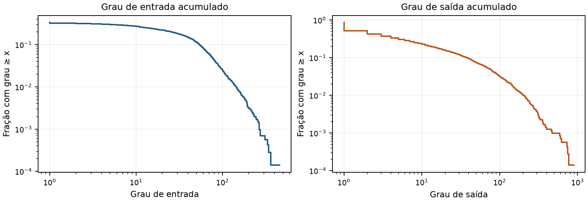

# Análise exploratória da Wiki-Vote para contenção de propagação

Kauê de Oliveira Silva
GCC118 Programação Matemática - UFLA - Semestre 2026/2
Etapa 1: coleta e estudo dos dados - 8 de outubro de 2026
Atualizado em 12 de outubro de 2026

**Repositório do trabalho:** [github.com/kaue-oliveira/gcc118-contencao-propagacao](https://github.com/kaue-oliveira/gcc118-contencao-propagacao)

## 1 Objetivo e escopo

Este relatório analisa o tamanho, a qualidade e a viabilidade da rede Wiki-Vote para estudar a contenção de propagação por remoção de vértices. A base contém 7.115 vértices e 103.689 arcos dirigidos, sem registros inválidos, duplicatas ou laços. Além dessas contagens, o estudo examina como a estrutura da rede e a escolha das origens influenciam o alcance da propagação.

O problema parte de uma rede G = (V, A) e de um conjunto S de vértices inicialmente infectados ou ativados. O objetivo é remover exatamente c vértices fora de S para reduzir o número de vértices que podem ser alcançados a partir dessas origens. A contagem inclui os próprios vértices de S. Nesta etapa, a análise considera a rede sem remoções; a comparação entre soluções exatas e heurísticas será feita nas etapas seguintes.

## 2 Fonte e significado dos dados

O arquivo `Wiki-Vote.txt.gz` foi obtido do SNAP em 08/10/2026 e reúne relações de votação em eleições para administradores da Wikipédia até janeiro de 2008. Cada ID representa um usuário, e um arco i → j indica que o usuário i votou no usuário j. A análise mantém os IDs e a direção dos arcos, usando um grafo simples e sem pesos. Como a base registra votos, a propagação por caminhos é uma hipótese adotada para o experimento, sem representar um contágio observado.

| Característica | Valor verificado |
| --- | --- |
| Vértices distintos | 7.115 |
| Registros e arcos distintos | 103.689 |
| Arquivo comprimido | 290.339 bytes |
| Conteúdo descomprimido | 1.095.061 bytes |
| Densidade dirigida sem laços | 0,00204854 (0,2049%) |

A densidade foi calculada como |A| / (|V| × (|V| - 1)). Apenas cerca de 0,20% dos arcos possíveis estão presentes, o que caracteriza a rede completa como esparsa. O arquivo original foi preservado no repositório.

<!-- pagebreak -->

## 3 Preparação e qualidade dos registros

Após a descompressão, foram desconsideradas as quatro linhas de comentário do cabeçalho. Cada registro foi conferido para verificar se continha duas colunas com IDs inteiros não negativos. Também foram procurados registros repetidos, laços e relações nos dois sentidos. Não foram encontradas linhas em branco nem registros que precisassem ser excluídos.

| Verificação | Resultado | Decisão |
| --- | --- | --- |
| Registros válidos | 103.689 | Todos preservados |
| Linhas inválidas | 0 | Nenhuma exclusão por erro |
| Duplicatas excedentes | 0 | Nenhuma deduplicação efetiva |
| Laços i → i | 0 | Nenhuma remoção efetiva |
| Pares recíprocos | 2.927 | Manter os dois sentidos |
| Arcos em pares recíprocos | 5.854 | São relações distintas |

Embora o cabeçalho contenha uma observação sobre pares sem orientação, os dados incluem 2.927 pares com arcos nos dois sentidos. Essas relações foram mantidas, pois i → j e j → i representam votos diferentes. Os resultados de graus, componentes e alcançabilidade também foram conferidos por uma segunda implementação, sem diferenças nas medidas analisadas.

Essas verificações confirmam que os registros podem ser lidos e usados na construção do grafo. Ainda assim, não garantem que todos os votos históricos estejam presentes. O arquivo não informa o sinal ou a data de cada voto, nem permite identificar usuários isolados que não aparecem em nenhum arco.

## 4 Componentes e conectividade

| Medida | Resultado |
| --- | --- |
| Componentes fracamente conexas (WCCs) | 24 |
| Maior componente fraca | 7.066 vértices e 103.663 arcos |
| Demais componentes fracas | 3 de tamanho 3 e 20 de tamanho 2 |
| Componentes fortemente conexas (SCCs) | 5.816 |
| Maior componente forte | 1.300 vértices e 39.456 arcos |
| Demais componentes fortes | 5.815 de tamanho 1 |

Uma componente fraca reúne vértices conectados quando se ignora a direção dos arcos. Em uma componente forte, cada vértice pode alcançar todos os demais por caminhos dirigidos. A maior componente fraca contém 99,31% dos vértices, enquanto a maior forte contém 18,27%. Assim, quase toda a rede está conectada quando se desconsidera a direção, mas uma origem não consegue necessariamente alcançar todos esses vértices.

As contagens coincidem com os valores correspondentes da tabela do SNAP. Há uma diferença entre os números do texto descritivo da página e os da tabela: os primeiros coincidem com a maior componente fraca, enquanto os últimos descrevem a rede completa. Neste relatório, os resultados gerais se referem à rede completa; os recortes são apresentados separadamente.

<!-- pagebreak -->

## 5 Distribuição dos graus

O grau de entrada corresponde ao número de arcos recebidos por um vértice, e o grau de saída, ao número de arcos que partem dele. As duas medidas foram analisadas separadamente. Os percentis foram calculados por interpolação linear, e o desvio padrão considera todos os vértices da rede.

| Estatística | Entrada | Saída |
| --- | --- | --- |
| Mínimo | 0 | 0 |
| Mediana | 0 | 2 |
| Média | 14,57 | 14,57 |
| Percentil 75 | 13 | 9 |
| Percentil 95 | 76 | 75 |
| Máximo | 457 | 893 |
| Desvio populacional | 31,73 | 42,28 |
| Vértices com grau zero | 4.734 | 1.005 |

Figura 1. Fração de vértices com grau ≥ x. O cálculo considera todos os 7.115 vértices. Os graus zero não aparecem no eixo horizontal porque a escala é logarítmica, mas permanecem no denominador. Fonte: graus calculados a partir da Wiki-Vote.

A média de 14,57 é bem maior que as medianas de entrada e saída, indicando que as ligações se concentram em uma parcela dos vértices. Os cinco maiores graus de saída pertencem aos IDs 2565 (893), 766 (773), 11 (743), 457 (732) e 2688 (618). Esses valores ajudam a descrever a rede, mas o grau, por si só, não determina quais remoções contêm melhor a propagação.

Há 1.005 vértices sem arcos de saída, cerca de 14,13% da rede. Se um deles for a única origem, a propagação permanece nesse próprio vértice. Além disso, os 4.734 vértices sem arcos de entrada só podem ser alcançados se já fizerem parte de S. Por isso, a escolha das origens deve considerar essas diferenças na estrutura da rede.

<!-- pagebreak -->

## 6 Diagnóstico de alcançabilidade inicial

Foram avaliados seis cenários sem remoções (c = 0), usando busca em largura para seguir os arcos a partir de S. No primeiro grupo, as origens são os vértices de maior grau de saída, com desempate pelo menor ID. No segundo, os IDs foram sorteados a partir da lista ordenada de vértices, usando `random.Random(42).sample`. Cada grupo começa com uma origem e acrescenta vértices da mesma seleção até chegar a três e cinco origens.

| Critério | Conjunto inicial S | Alcançados |
| --- | --- | --- |
| Maior saída | {2565} | 2.316 |
| Maior saída | {2565, 766, 11} | 2.320 |
| Maior saída | {2565, 766, 11, 457, 2688} | 2.325 |
| Aleatório 42 | {5931} | 1 |
| Aleatório 42 | {5931, 991, 215} | 2.317 |
| Aleatório 42 | {5931, 991, 215, 6967, 2453} | 2.318 |

A origem 2565 alcança 2.316 vértices, ou 32,55% da rede. Ao acrescentar quatro origens com alto grau de saída, a contagem sobe para 2.325, um aumento de apenas nove vértices. Isso mostra que boa parte dos vértices alcançados por essas origens é compartilhada, embora o mesmo comportamento não possa ser presumido para qualquer conjunto S.

No cenário S = {5931}, apenas a própria origem é alcançada, pois ela não tem arcos de saída. Como os vértices de S não podem ser removidos, nenhuma intervenção pode reduzir essa contagem abaixo de 1. Esse caso serve como controle, mas seria insuficiente para comparar o desempenho dos métodos de contenção.

Os experimentos seguintes deverão incluir origens de alto grau e diferentes seleções aleatórias, registrando as sementes usadas e identificando os casos triviais. Os seis cenários apresentados ajudam a entender a base, mas um único sorteio não permite generalizar o comportamento de todas as origens nem avaliar a qualidade de métodos de remoção.

## 6.1 Convenções das instâncias

Uma instância do problema é definida pelo grafo, pelo conjunto inicial S e pelo orçamento c. Como apenas vértices fora de S podem ser removidos, o orçamento deve satisfazer 0 ≤ c ≤ |V| - |S|. A direção original dos arcos é mantida em todos os casos.

Os recortes foram armazenados com listas separadas de vértices e arcos. Essa separação permite preservar vértices mesmo quando eles não têm ligações dentro do recorte. Os arquivos e as configurações de S e c estão disponíveis no repositório.

<!-- pagebreak -->

## 7 Recortes e viabilidade para otimização

Foram gerados recortes de 100, 300 e 1.000 vértices por busca em largura a partir do ID 2565. A seleção ignora a direção e visita os vizinhos por ID crescente. Os recortes mantêm todos os arcos entre os vértices selecionados, com os sentidos originais, e os menores estão contidos nos maiores.

| Vértices | Arcos | Densidade | SCCs | Alcançados |
| --- | --- | --- | --- | --- |
| 100 | 961 | 9,71% | 47 | 77 |
| 300 | 6.962 | 7,76% | 100 | 256 |
| 1.000 | 32.207 | 3,22% | 399 | 867 |

Todos os recortes têm uma componente fraca, usam S = {2565} e terão testes com c ∈ {1, 3, 5, 10}. A seleção próxima de um vértice muito conectado eleva a densidade. Portanto, os recortes não são representativos da rede inteira, e seu menor tamanho não garante facilidade de resolução.

O modelo compacto IF de Agra e Samuco prevê 3|V| variáveis e |A| + |V| + 1 restrições principais, com as fixações das origens tratadas como limites das variáveis. A tabela apresenta essas estimativas; as contagens efetivas serão conferidas na implementação.

| Instância | Variáveis previstas | Restrições principais |
| --- | --- | --- |
| 100 vértices | 300 | 1.062 |
| 300 vértices | 900 | 7.263 |
| 1.000 vértices | 3.000 | 33.208 |
| Rede completa | 21.345 | 110.805 |

A análise e a geração dos recortes levaram 0,37 segundo na execução registrada, em Python 3.12.3. O processamento dos dados é viável; a resolução do modelo de programação inteira ainda precisa ser avaliada. Os testes começarão pelos recortes menores, registrando tempo, gap e status.

A Wiki-Vote não está entre as seis redes reais da seção 7.1 do artigo-base. Isso permite estudar outra rede, sem afirmar que seu uso seja inédito na literatura.

## 8 Conclusão

A Wiki-Vote oferece dados consistentes para iniciar os experimentos de contenção. Não foram encontrados registros que exigissem exclusão, e os recortes permitem avaliar o modelo exato em tamanhos crescentes.

A direção dos arcos, a escolha das origens e o viés dos recortes deverão orientar a comparação entre o modelo exato, as heurísticas e a busca local iterada. Os resultados de um único cenário não devem ser generalizados para toda a rede. Os dados, o código e as instruções de execução estão no repositório indicado no início do relatório.

## Referências

SNAP. [Wikipedia vote network](https://snap.stanford.edu/data/wiki-Vote.html). Dados obtidos em 08/10/2026. Acesso em 12/10/2026.

AGRA, A.; SAMUCO, J. M. Interdiction Models and Heuristics for Graph Propagation. Networks, 2026. [DOI: 10.1002/net.70047](https://doi.org/10.1002/net.70047).
