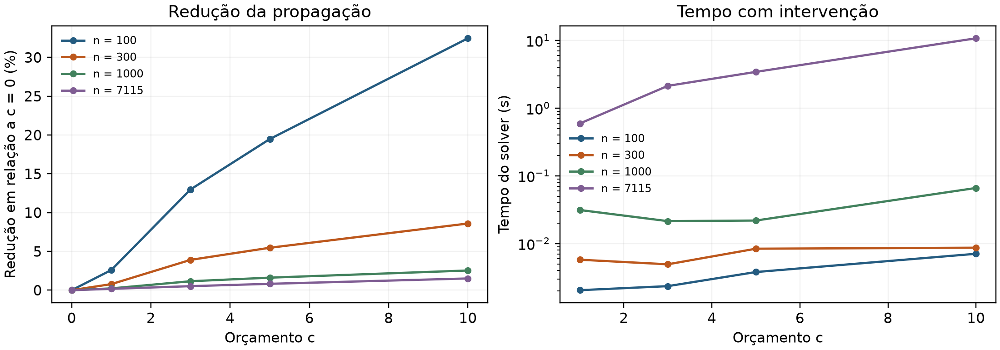

# Formulação exata e testes no solver

Kauê de Oliveira Silva | GCC118 - Programação Matemática | UFLA - 2026/2

## 1 Problema e formulação

Dado o grafo dirigido G=(V,A), um conjunto inicial S e um orçamento inteiro c, remover exatamente c vértices fora de S para minimizar o alcance da propagação no grafo restante. As origens são protegidas e entram na contagem. Usam-se os mesmos dados e recortes Wiki-Vote auditados na etapa 1.

Sejam n o número de vértices, m o de arcos e k o de origens, com S não vazio e 0 ≤ c ≤ n-k. A variável binária v indica remoção; y representa alcance e z é auxiliar de não afetação. y e z são contínuas. Implementa-se a formulação compacta da proposta:

$$
\begin{aligned}
\min \quad \sum_{i\in V} y_i \\
\sum_{i\in V}v_i=c \\
z_i-z_j+v_i\geq 0 \quad \forall(i,j)\in A \\
z_i+y_i+v_i\geq 1 \quad \forall i\in V \\
v_s=z_s=0 \quad \forall s\in S \\
v_i\in\{0,1\},\quad 0\leq y_i,z_i\leq 1 \quad \forall i\in V
\end{aligned}
$$

**Exatidão.** Fixadas as remoções D, seja R o conjunto alcançável sem D. Como z=0 nas origens, as restrições de arco forçam z=0 ao longo de qualquer caminho não interrompido; a cobertura exige y=1 em R. Logo, o objetivo é pelo menos o tamanho de R. Reciprocamente, v=1 em D, y=1 em R e z=1 fora de R e D, com zero nos demais casos, satisfaz todas as restrições e atinge esse valor. Portanto, minimizar o modelo equivale a minimizar a propagação.

Os limites superiores 1 de y e z preservam essa construção. Não se exige sua binariedade. As fixações de S são limites de variáveis, sem acrescentar linhas à matriz.

## 2 Tamanho do modelo

São **3n variáveis**, sendo n binárias e 2n contínuas, e **m+n+1 restrições**: m de propagação, n de cobertura e uma de orçamento. As contagens efetivas, antes do presolve, foram:

| Vértices | Arcos | Variáveis | Restrições |
| --- | --- | --- | --- |
| 100 | 961 | 300 | 1062 |
| 300 | 6962 | 900 | 7263 |
| 1000 | 32207 | 3000 | 33208 |
| 7115 | 103689 | 21345 | 110805 |

O número de variáveis e restrições não depende do orçamento nem da escolha de S.

<!-- pagebreak -->

## 3 Cenários e protocolo

O núcleo mantém os **12 cenários previstos na etapa 1**. Os complementos examinam origens e viabilidade na rede completa, com comparações nos mesmos orçamentos. A quantidade de casos resulta desse cruzamento:

| Bloco | Comparação | Casos |
| --- | --- | --- |
| Núcleo | n=100/300/1.000; S={2565}; c=1/3/5/10 | 12 |
| Escala e referência | c=0 nas quatro escalas e c=1/3/5/10 na rede completa | 8 |
| Origens no recorte | n=300; k=1/3/5; maior saída ou três sorteios; quatro orçamentos | 44 |
| Origens na rede completa | k=3; quatro perfis; quatro orçamentos | 16 |
| Controle sem saída | S={5931}; c=0 e c=10; ótimo conhecido igual a 1 | 2 |

No recorte de 300, maior saída com k=1 coincide com S={2565} e já pertence ao núcleo. Os sorteios usam sementes 42, 123 e 2026; os conjuntos de k=1/3/5 são aninhados. São casos exploratórios, sem inferência estatística sobre todas as origens.

Gurobi 12.0.3, Python 3.12.3; processador 13th Gen Intel(R) Core(TM) i7-13620H. Execução sequencial, uma thread, semente do solver 42 e limite de **30 s por caso**, com MIPGap=MIPGapAbs=0. O limite controla recursos e não garante otimalidade. Runtime mede apenas a resolução; montagem e tempo total também ficam registrados no CSV. Uma execução por cenário, sem médias de desempenho.

## 4 Resultados do núcleo

Todos os casos abaixo tiveram ótimo provado. f* inclui as origens; t é o tempo do solver.

| n | c | f* | t (s) | Gap (%) |
| --- | --- | --- | --- | --- |
| 100 | 1 | 75 | 0,002 | 0,00 |
| 100 | 3 | 67 | 0,002 | 0,00 |
| 100 | 5 | 62 | 0,004 | 0,00 |
| 100 | 10 | 52 | 0,007 | 0,00 |
| 300 | 1 | 254 | 0,006 | 0,00 |
| 300 | 3 | 246 | 0,005 | 0,00 |
| 300 | 5 | 242 | 0,008 | 0,00 |
| 300 | 10 | 234 | 0,009 | 0,00 |
| 1000 | 1 | 865 | 0,031 | 0,00 |
| 1000 | 3 | 857 | 0,021 | 0,00 |
| 1000 | 5 | 853 | 0,022 | 0,00 |
| 1000 | 10 | 845 | 0,066 | 0,00 |

Com c=10, a redução foi de 32,47% no recorte de 100 e 1,51% na rede completa. O orçamento equivale a 10,10% e 0,14% dos candidatos, respectivamente; a diferença não pode ser atribuída somente ao tamanho ou à topologia.

<!-- pagebreak -->

## 5 Análise dos cenários complementares

Na rede completa, S={2565} e c=10 produziram 2281 alcançados em 10,744 s, com gap zero, contra 2316 sem remoção. Nos 44 casos adicionais de origens do recorte de 300, houve 44 ótimos; o maior tempo foi 5,508 s.

Fixando a rede completa e k=3, a identidade das origens muda fortemente o resultado:

| Perfil de S | Inicial | c=3 | c=5 | c=10 |
| --- | --- | --- | --- | --- |
| Maior saída | 2320 | 2308 | 2301 | 2285 |
| Sorteio 42 | 2317 | 2305* | 2298* | 2283* |
| Sorteio 123 | 2317 | 2305* | 7 | 3 |
| Sorteio 2026 | 2317 | 2305* | 2301* | 5 |

Os valores são alcançados finais. * indica solução viável sem prova de ótimo. O sorteio 123 atinge o mínimo teórico de três origens com c=10; outros conjuntos ainda permitem grande propagação. Os IDs de S e das remoções estão no manifesto.

## 5.1 Casos sem prova de ótimo em 30 segundos

| Perfil | c | Viável | Limite inferior | Gap (%) | t (s) |
| --- | --- | --- | --- | --- | --- |
| Sorteio 42 | 3 | 2305 | 2294,86 | 0,44 | 30,00 |
| Sorteio 42 | 5 | 2298 | 2260,68 | 1,62 | 30,00 |
| Sorteio 42 | 10 | 2283 | 2179,13 | 4,55 | 30,00 |
| Sorteio 123 | 3 | 2305 | 2245,65 | 2,57 | 30,00 |
| Sorteio 2026 | 3 | 2305 | 2272,47 | 1,41 | 30,00 |
| Sorteio 2026 | 5 | 2301 | 1250,67 | 45,65 | 30,00 |

Todos pertencem à rede completa, com k=3, e encerraram como TIME_LIMIT. Para minimizar, o ótimo está entre o limite inferior e o valor viável. O gap é abs(ObjVal-ObjBound)/abs(ObjVal), calculado com a precisão original; a tabela arredonda apenas a apresentação.

No total, foram **76 ótimos em 82 cenários** e 6 encerramentos por tempo, com maior gap de 45,65%. Os controles S={5931} permaneceram em uma origem alcançada, com gap zero. Esse controle verifica o código; não representa redução causada pelas remoções.

As diferenças entre perfis e orçamentos mostram que n e m, isoladamente, não determinam a dificuldade. As soluções interrompidas fornecem referências de qualidade, mas não devem ser tratadas como ótimos conhecidos.

<!-- pagebreak -->

## 6 Leitura conjunta dos resultados

Figura 1. Redução relativa à BFS sem intervenção e tempo de resolução para S={2565}. O painel de tempo usa escala logarítmica e apenas c&gt;0; c=0 é controle e está registrado nas tabelas completas. São medições individuais.

## 6.1 Verificação e limites da análise

Foram aprovados **19 testes**, incluindo **1196 comparações com enumeração completa** em grafos pequenos. Todas as 82 soluções reais foram reavaliadas por BFS. CSV, JSON, logs e os quatro LPs exportados foram confrontados; os dados e recortes da etapa 1 foram reproduzidos em pasta temporária, sem alterar os originais.

A Wiki-Vote registra votos: a propagação é uma hipótese sobre sua topologia. Os recortes são induzidos perto de 2565 e não representam uma amostra da rede inteira. Três sementes e uma execução por cenário não sustentam conclusões estatísticas de desempenho. Os gaps residuais limitam as conclusões de otimalidade na rede completa.

## 6.2 Continuidade do trabalho

A etapa 2 entrega um benchmark para as heurísticas e a busca local da etapa 3. Nos casos provados, a comparação usa f*. Nos demais, deve usar a solução viável e o limite inferior, mantendo grafo, S e c idênticos. O gráfico heurística versus exato e a análise experimental consolidada ficam para as próximas etapas.

**Dados e resultados.** A configuração está em experimentos/etapa-2.json. Resultados, soluções e evidências ficam em resultados/etapa-2/. Os dois lotes anteriores estão separados no arquivo histórico e não entram nas conclusões. A soma de Runtime no lote final foi 223,35 s.

## Referências

AGRA, A.; SAMUCO, J. M. Interdiction Models and Heuristics for Graph Propagation. Networks, 2026. [DOI 10.1002/net.70047](https://doi.org/10.1002/net.70047). Formulação apresentada na proposta de tema do trabalho.

SNAP. [Wikipedia vote network](https://snap.stanford.edu/data/wiki-Vote.html). Base auditada na etapa 1.

GUROBI. [Model attributes](https://docs.gurobi.com/projects/optimizer/en/current/reference/attributes/model.html). Definições das métricas consultadas no solver.
